# CommerceIQ — End-to-End E-Commerce Analytics, BI & Predictive Platform

[](https://github.com/Gunjan-Bansal1/CommerceIQ/actions/workflows/ci.yml)

**CommerceIQ** is an end-to-end Data Engineering, Business Intelligence, Statistical Inference, Predictive Modeling, and Decision Intelligence platform built on historical Brazilian e-commerce and marketing funnel datasets (`2016–2018`). All headline KPIs reconcile cleanly across Python, MySQL, SQL Analytics, Excel COM, Power BI, and the 10-page Streamlit studio (`43 / 43` automated tests passing).

> **Governance Note:** Independent educational portfolio case study (not affiliated with Olist). Monetary values (`BRL`) are recorded item/payment totals—not net marketplace profit—and decision simulations use explicitly labeled illustrative assumptions.

---

## Verified Key Findings (`2016–2018` Baseline)

| Domain | Key Verified Result | Artifact |
|---|---|---|
| **Pipeline Scale** | **1,559,806** raw rows (`12` CSVs) → **1,299,152** cleaned rows (`13` Parquet/CSV tables, `165` fields, `27` engineered features) | [`clean.py`](src/transformation/clean.py) |
| **Commercial Scale** | **99,441** orders (**96,478** delivered) \| **BRL 13,221,498.11** delivered merchandise \| **BRL 13,591,643.70** GMV \| **BRL 16,008,872.12** payments \| **BRL 137.04** AOV | [`sql_analytics_report.md`](reports/sql_analytics_report.md) |
| **Customer Intelligence** | **93,358** unique buyers (`customer_unique_id`) \| **3.00%** repeat rate (**2,801** repeat buyers) \| **K-Means `k=3`** (`Silhouette = 0.3983`) | [`customer_intelligence_report.md`](reports/customer_intelligence_report.md) |
| **Logistics & SLA** | **93.2269%** on-time delivery (`89,936 / 96,470`) \| **12.56 days** mean total delivery (**9.33 days** carrier transit) | [`eda_findings_report.md`](reports/eda_findings_report.md) |
| **Statistical Inference** | Late delivery drops rating by **2.02 stars** (`4.29` on-time vs. `2.27` late; *p* < 1e-100, Cohen *d* = **1.71**); route distance drives duration (Spearman *ρ* = **0.543**) | [`statistical_findings_report.md`](reports/statistical_findings_report.md) |
| **Marketing & Exceptions** | **8,000** qualified leads → **842** closed deals (**10.53%** conversion) \| **1,234** canceled/unavailable orders (**BRL 97,242.96** known exposure) | [`02_revenue_leakage_and_exceptions.sql`](sql/03_analytics/02_revenue_leakage_and_exceptions.sql) |
| **Demand Forecasting** | 12-week holdout (`Jun–Aug 2018`): **Holt-Winters 17.97% WAPE** (merch BRL) \| **4-wk Moving Avg 17.14% WAPE** (order volume) | [`forecasting_model_card.md`](reports/forecasting_model_card.md) |
| **Checkout Delay Risk ML** | Zero-leakage `HistGradientBoosting` on unseen `Jun–Aug 2018` orders: **0.7325 ROC-AUC**, **0.0771 PR-AUC** (>2.1x baseline) | [`delivery_risk_model_card.md`](reports/delivery_risk_model_card.md) |

---

## Visual Showcase

### 1. Interactive Streamlit Studio (`app/main.py` — 10 Pages, Live MySQL + ML Scorer)
| Executive Overview | Geographic Analytics (Brazil) |
|---|---|
| 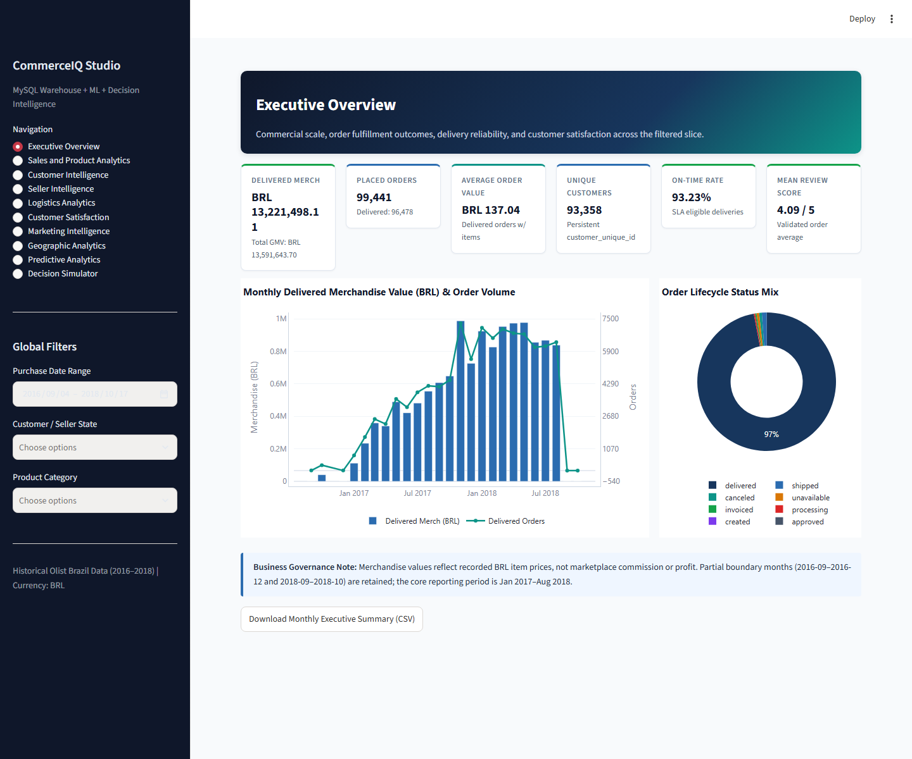 | 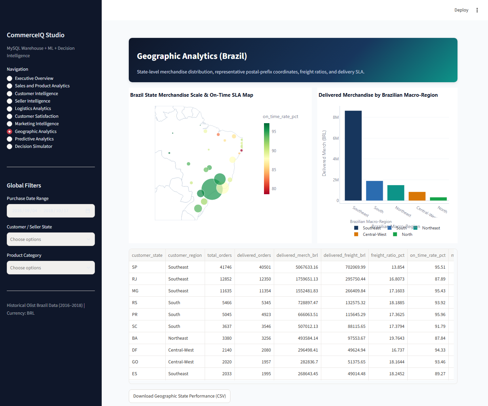 |

| Predictive Analytics & Backtesting | Decision Intelligence Simulator |
|---|---|
| 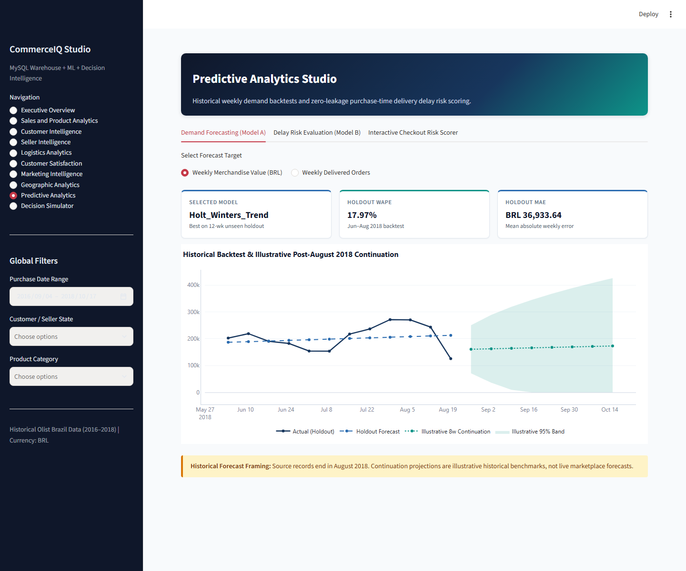 | 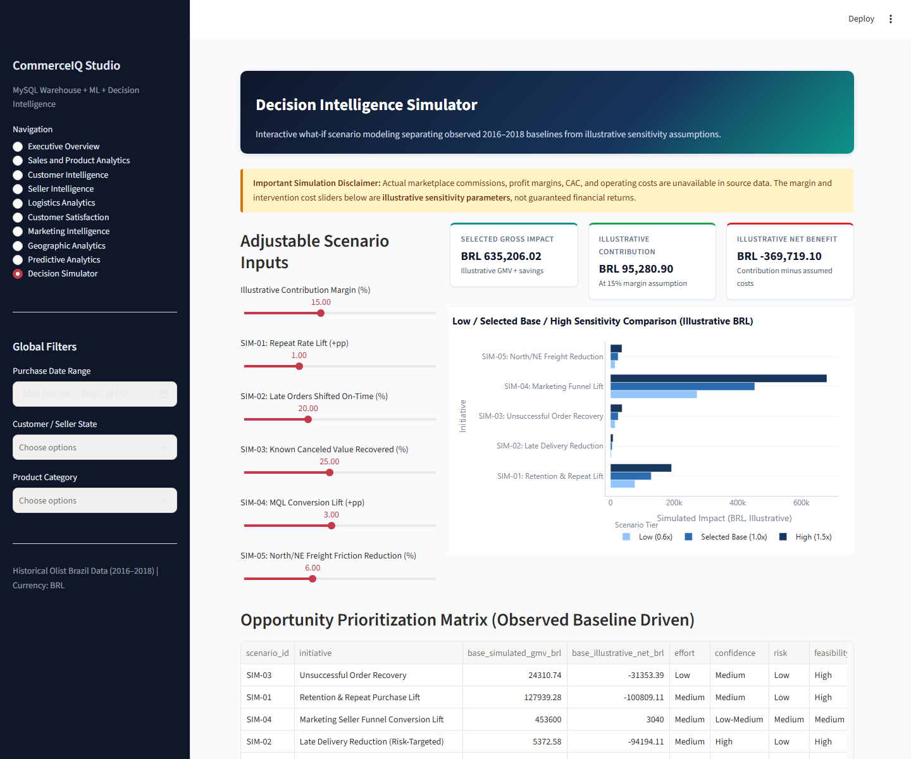 |

### 2. Automated Excel BI Workbooks (`excel/` — PivotTables, Slicers & Live Tier Selector)
| Executive Dashboard (COM Recalculated) | PivotTable, PivotChart & 3 Slicers |
|---|---|
| 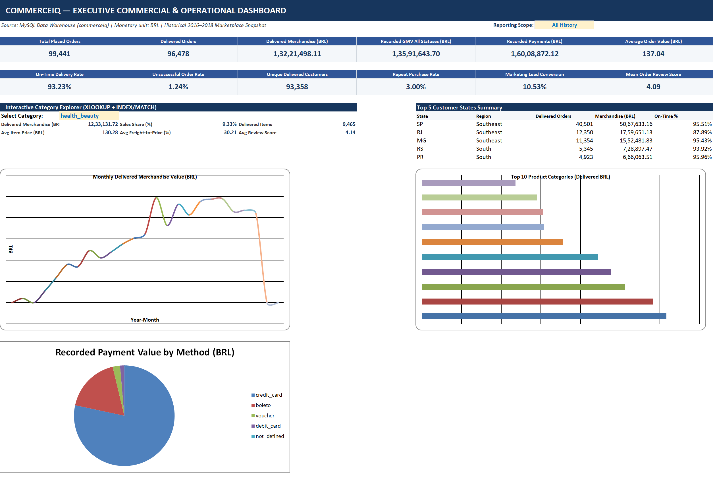 | 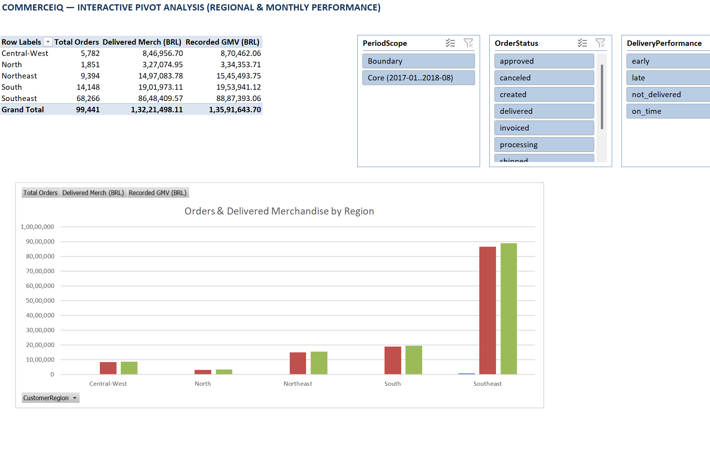 |

| Decision Simulator (`Low / Base / High` Dropdown) |
|---|
| 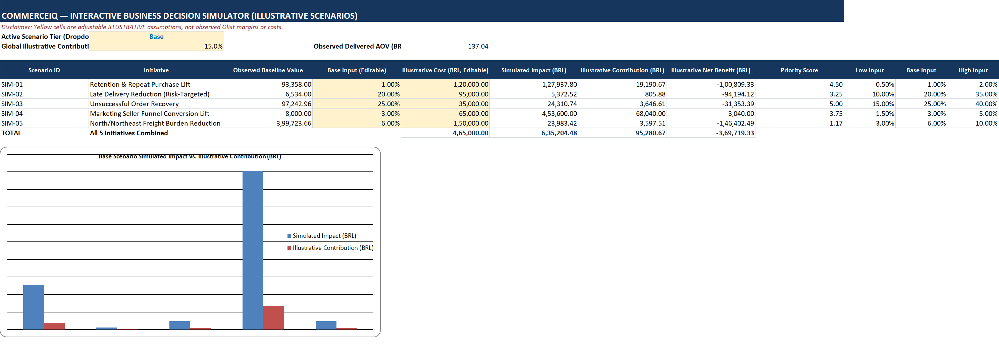 |

### 3. Power BI Semantic Model & Report ([`powerbi/CommerceIQ.pbip`](powerbi/CommerceIQ.pbip))
- **Architecture:** `17` TMDL tables (`12` MySQL warehouse dims/facts + `4` strongly typed `"en-US"` CSV analytical extensions + `_Measures`), `15` relationships, **`61` explicit DAX measures**, and **`10` PBIR pages / `84` visuals** (dropdown slicers, `pageNavigator`, maps, scatter plots, funnels, drill-through matrices).
- **Verified Refresh Fixes:** Power Query M filters `dim_date` (`date_key > 0 and full_date <> null` across `1,827` continuous calendar days) and normalizes `TINYINT(1)` columns to `Int64.Type` for MySQL Connector/NET (`MySql.Data.MySqlClient`). Automated PBIR/TMDL & key checks pass (`tests/test_warehouse_and_models.py`), and native Desktop refresh is user-confirmed working *(see [`docs/12_powerbi_architecture.md`](docs/12_powerbi_architecture.md))*.

### 4. Python EDA, Statistics, RFM Cohorts & ML Figures ([`reports/figures/`](reports/figures))
| Monthly Commercial Trends | Logistics & Regional SLA | Hypothesis Testing (`Holm-Bonferroni`) |
|---|---|---|
| 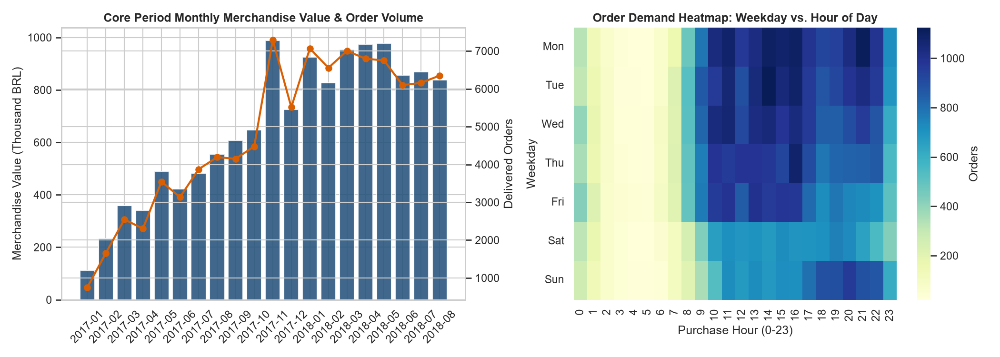 | 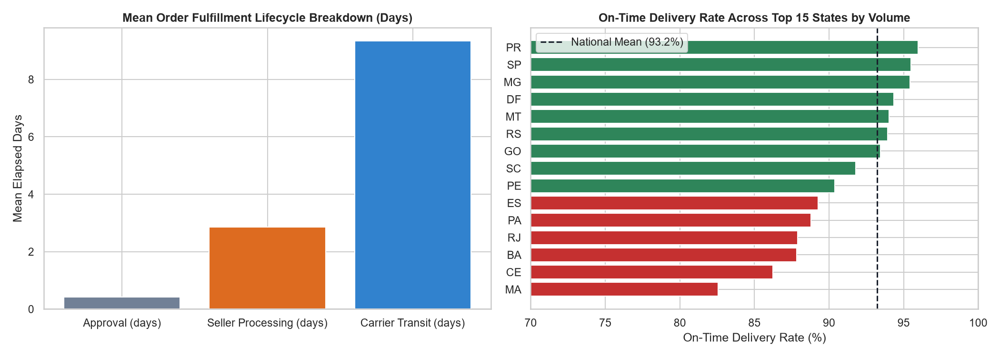 | 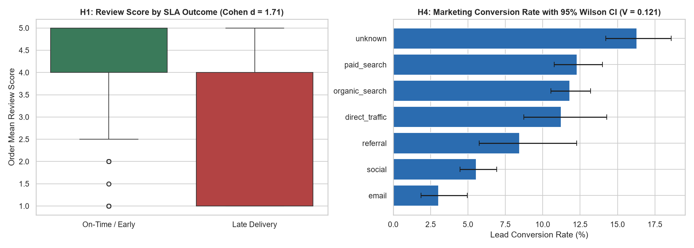 |

| Customer RFM & Cohort Retention | Demand Forecast Backtest | Checkout Delay Risk ML (`ROC / PR`) |
|---|---|---|
| 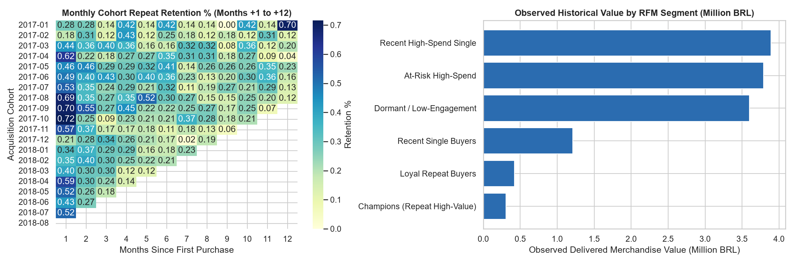 | 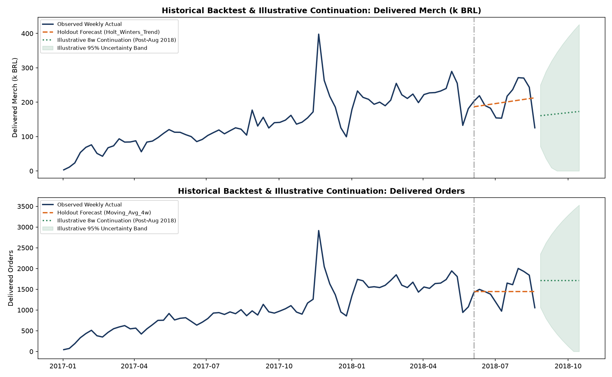 | 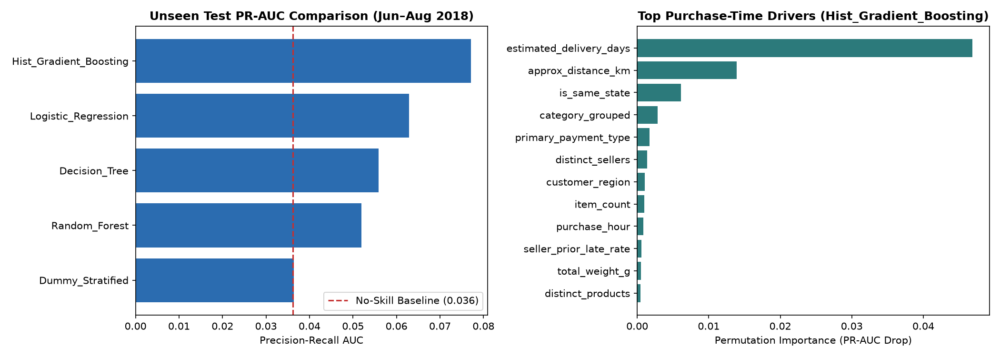 |

<details>
<summary>View 4 Additional Analytical Figures (Categories/Sellers, Satisfaction Themes, Payments/Funnel & Opportunity Matrix)</summary>

| Category & Seller Concentration | Satisfaction & Complaint Themes |
|---|---|
| 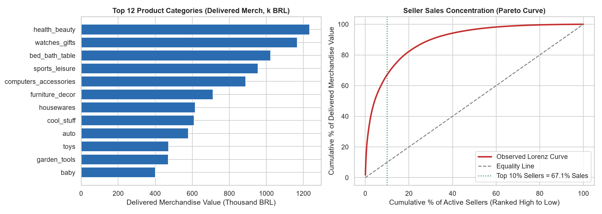 | 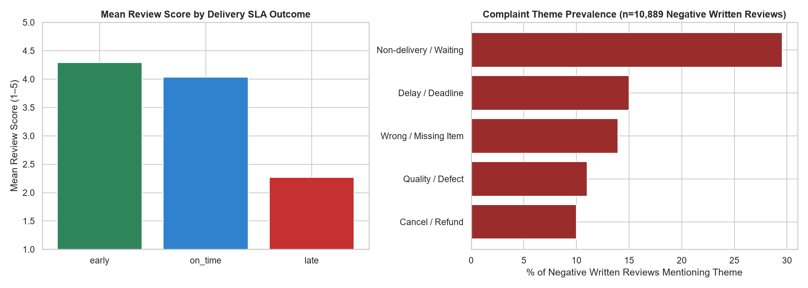 |

| Payments & Marketing Funnel | Decision Prioritization Matrix |
|---|---|
| 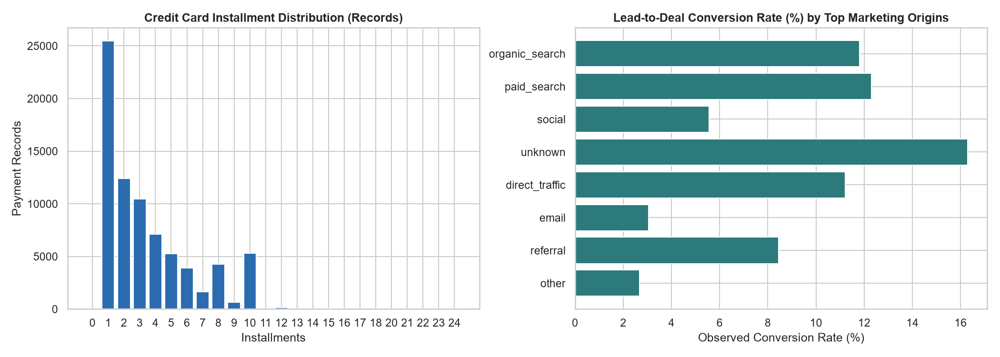 | 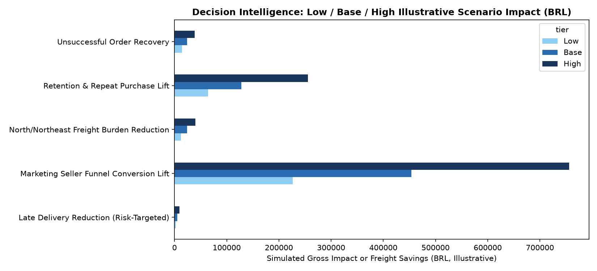 |

</details>

---

## Architecture & Repository Layout

```text
Raw CSVs (12) ─▶ Ingestion (SHA-256) ─▶ Cleaning (13 Parquet/CSV) ─▶ MySQL 8.0 Operational DB (13 Tables)
                                                                              │
                                                                              ▼
Power BI PBIP (61 DAX, 10 Pages) ◀─ Warehouse Star Schema (7 Dims, 5 Facts, 9 Marts) ─▶ 41 Domain SQL Queries
        ▲                                     │                                                  │
        │                                     ▼                                                  ▼
Streamlit Studio (10 Pages) ◀── Python EDA, Stats, RFM, Forecasting, Risk ML ──▶ Excel COM Workbook + Simulator
```

| Path | Contents |
|---|---|
| [`app/`](app) | 10-page Streamlit + Plotly studio (`main.py`, `data_access.py`, `theme.py`, view modules) & live screenshots |
| [`src/`](src) | Modular ingestion, cleaning, MySQL loader, warehouse builder, EDA/stats/RFM, forecasting, risk ML, simulator, Excel/Power BI generators |
| [`sql/`](sql) | Operational DDL/indexes (`01_schema`), Kimball star schema + 9 marts (`02_warehouse`), and 41 business queries (`03_analytics`) |
| [`notebooks/`](notebooks) | 8 executed Jupyter notebooks (`00_data_ingestion.ipynb` – `07_delivery_risk_classification.ipynb`) with saved outputs |
| [`excel/`](excel) & [`powerbi/`](powerbi) | Native Excel workbooks + Power Query `.pq` scripts; PBIP + TMDL semantic model + DAX + 10-page PBIR layout |
| [`pipelines/`](pipelines) & [`.github/`](.github) | Automated CLI orchestrator (`run_pipeline.py`) and GitHub Actions CI (`ci.yml`) |
| [`presentation/`](presentation) & [`docs/`](docs) | Executive slide deck (`CommerceIQ_Executive_Presentation.pptx`), architecture Mermaid diagrams, KPI dictionary & case study |
| [`reports/`](reports) & [`tests/`](tests) | Data profiling/cleaning workbooks, model cards, QA reconciliation reports, and `43` tests across `6` pytest suites |

---

## Quickstart & Commands

1. **Install dependencies & configure local MySQL**
   - Download the public [Olist E-Commerce](https://www.kaggle.com/datasets/olistbr/brazilian-ecommerce) and [Marketing Funnel](https://www.kaggle.com/datasets/olistbr/marketing-funnel-olist) CSVs into `data/raw/` (see [`docs/data_sources.md`](docs/data_sources.md)).
   - Copy `.env.example` to `.env` and set `DB_HOST`, `DB_PORT`, `DB_USER`, `DB_PASSWORD`, `DB_NAME=commerceiq`.
   ```powershell
   python -m venv .venv
   .venv\Scripts\Activate.ps1
   pip install -r requirements.txt
   ```
2. **Run end-to-end automated pipeline**
   ```powershell
   python pipelines/run_pipeline.py --stages all --train-models
   ```
3. **Launch interactive Streamlit Analytics Studio (`10` pages)**
   ```powershell
   python -m streamlit run app/main.py
   ```
4. **Open Power BI Desktop** — Ensure 64-bit MySQL Connector/NET (`MySql.Data.MySqlClient`) is installed, open [`powerbi/CommerceIQ.pbip`](powerbi/CommerceIQ.pbip), enter local MySQL credentials, and click **Refresh**.
5. **Run all `43` automated checks**
   ```powershell
   python -m pytest tests/ -v
   ```

---

## Scope Limitations & Licensing

- **Historical Window:** `2016–2018` (`Jan 2017–Aug 2018` core period); forecasts represent historical holdout backtests and illustrative continuations.
- **Data Boundaries:** Source logs omit commissions, COGS, refunds, CAC/ROAS, and city population (`GEO-08` excluded); `462` of `842` won marketing deals have no matching marketplace `seller_id`.
- **Licensing:** Olist datasets are used under CC BY-NC-SA 4.0; raw/processed data, `.env`, and model binaries are excluded via `.gitignore`.
